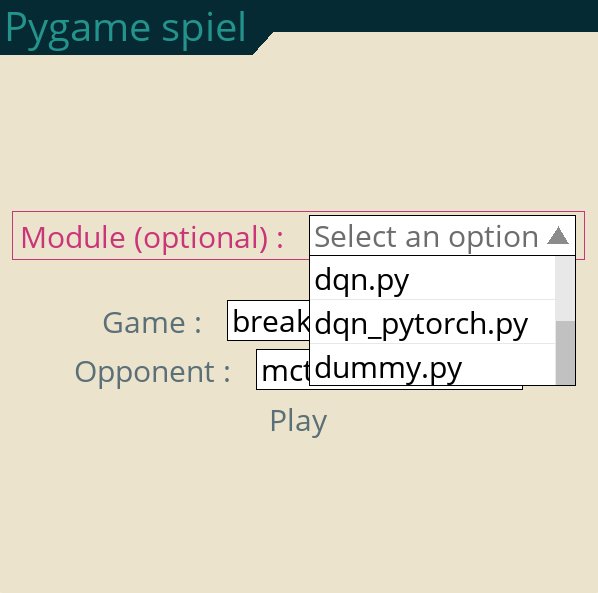
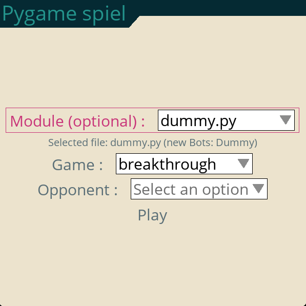
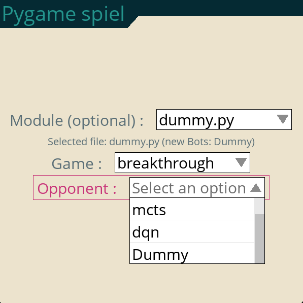

# Getting started

Complete [installation](installation.md) in the environment you will use. Real
backend and display qualification limits are listed in that guide.

## Play from the menu

```bash
python -m pygame_spiel.main
```

1. Choose `tic_tac_toe` or `breakthrough` in **Game**.
2. Choose a controller in **Opponent**: `mcts`, `random`, `human`, or `dqn`
   for Breakthrough with a [prepared checkpoint](installation.md#models-and-cache-paths).
3. Select **Play**.

Player 0 is human-controlled; **Opponent** controls player 1. The default
selection is Breakthrough against MCTS. Choosing `human` lets both players use
the mouse in turn.

For Tic Tac Toe, click a legal empty cell. For Breakthrough, click one of the
acting player's pawns, then its destination. Clicking the selected pawn again
deselects it. Moves stop at a terminal state; close the window to exit.

The optional **Module** selector loads Python code for the
[developer bot-file extension](#register-a-new-bot). Ordinary play with
built-in controllers does not require a bot file.

## Start a game directly

Bypass the menu to play Tic Tac Toe against the random controller:

```bash
python -m pygame_spiel.main --no-menu --game tic_tac_toe --opponent random --seed 42
```

The CLI assigns the opponent seed as the base `--seed` plus player ID 1, so this
example uses opponent seed 43. Frame rate affects the pace of bot turns.

| Option | Meaning |
| --- | --- |
| `--game` | `tic_tac_toe` or `breakthrough`; default `breakthrough` |
| `--opponent` | `mcts`, `random`, `human`, or Breakthrough-only `dqn`; default `mcts` |
| `--seed` | Base integer seed from 0 through 4294967294; default 42 |
| `--fps` | Frame limit from 1 through 240; default 10 |
| `--no-menu` | Start the configured game directly |
| `--cache-dir` | Override the [user cache](installation.md#models-and-cache-paths) |
| `--model-path` | Select an external DQN checkpoint directory |
| `--help` | Show usage without opening a display |

View the complete options:

```bash
python -m pygame_spiel.main --help
python -m pygame_spiel.downloads --help
```

An installed package also provides `pygame_spiel` and `pygame_spiel_download`.
From a source checkout, `python main.py` invokes the application entry point.
`pygame_spiel` and `python main.py` accept the same game options as the module
launcher. The downloader has its own help and arguments.

For Python configuration, custom controllers and manual frame handling, see
[Extending the application](extending.md).

## Register a new bot
Custom Python bot files are the developer extension for testing algorithms.
Selecting a file executes its Python code.

To dynamically add new algorithms, Pygame_spiel uses the Bot class from pyspiel as interface (pyspiel.Bot). This class is present in the OpenSpiel library, and it's currently used as template for other available algorithms in OpenSpiel (e.g., [MCTSBot](https://github.com/google-deepmind/open_spiel/blob/master/open_spiel/python/algorithms/mcts.py), [RandomUniform](https://github.com/google-deepmind/open_spiel/blob/master/open_spiel/python/bots/uniform_random.py), [Human](https://github.com/google-deepmind/open_spiel/blob/master/open_spiel/python/bots/human.py), ...). This class offers a useful format to create a generic interface between new algorithms and Pygame_spiel. The user can create a new class, which includes the logic of their new algorithm.

### Create a Bot class
In the snippet below we show an example of a simple Bot which always select the first legal action:

```python
import pyspiel

class Dummy(pyspiel.Bot):

  def __init__(self, game, player_id):
    pyspiel.Bot.__init__(self)
    self._player_id = player_id

  def step(self, state):
    legal_actions = state.legal_actions(self._player_id)
    if not legal_actions:
      return pyspiel.INVALID_ACTION
    action = legal_actions[0] # Always choose 1st action
    return action
```
This class definition can be saved in a .py file in any folder.
**NOTE:** There are two requirements when creating a new Bot:
1) The class needs to be inherited from pyspiel.Bot
2) The class needs to have the two mandatory arguments **game** and **player_id**. While these might not be used by the Bot, Pygame_spiel expects these parameters.

### Register the  class
After launching Pygame_spiel, the user can provide the path the the Python file containing the Bot definition, which will be loaded and visible in the list of Bots (called "Opponent" in the main menu). In the *Module* dropdown menu navigate through the filesystem and select the Python file



After selecting the file, the file name will be visualized below the dropdown menu as in the next image. Also, if the Python file contains classes inherited from pyspiel.Bot, the class names will be printed next to the file name. This information can be used to know if the Bots have been correctly registered or not. If no names are printed after the text "new Bots:", the classes have not been correctly registered.



If the new classes are correctly registered, the class names will appear in the *Opponent* dropdown menu, after the Bots which are already available in Pygame_spiel by default (see the new class "Dummy" in the image below).



After this, just click on *Play*!.
